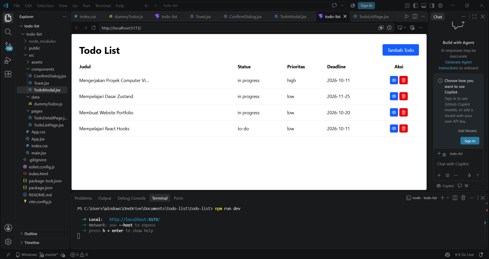
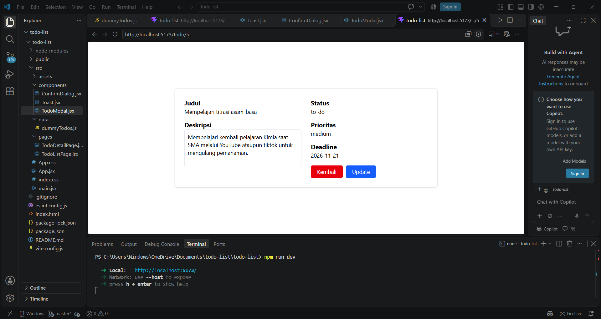
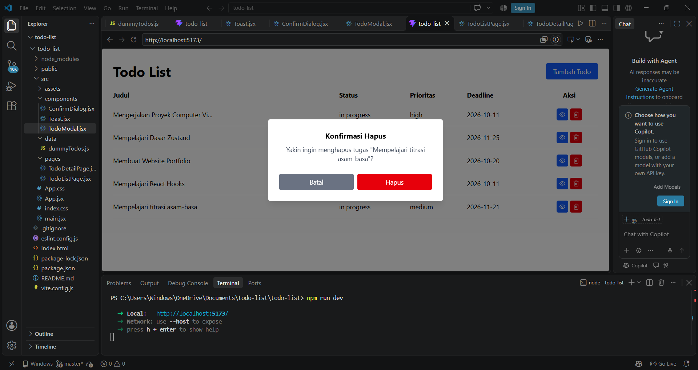
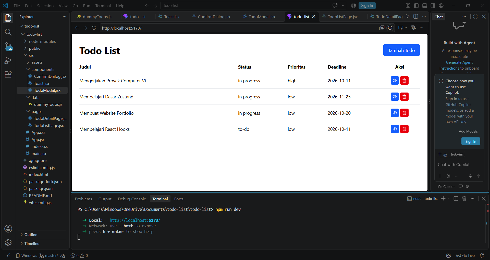

## Screenshot Hasil Implementasi
Dokumentasi hasil implementasi aplikasi Todo List.

### 1. Tampilan Awal Aplikasi

### 2. Tombol Tambah Todo

### 3. Mengisi Form Todo

### 4. Todo Berhasil Ditambahkan

### 5. Mengecek Detail Todo

### 6. Mengedit Todo

### 7. Hasil Setelah Update

### 8. Menghapus Todo

### 9. Todo Berhasil Dihapus
