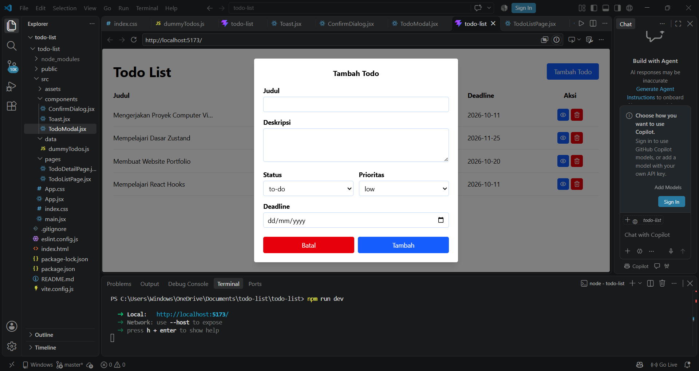
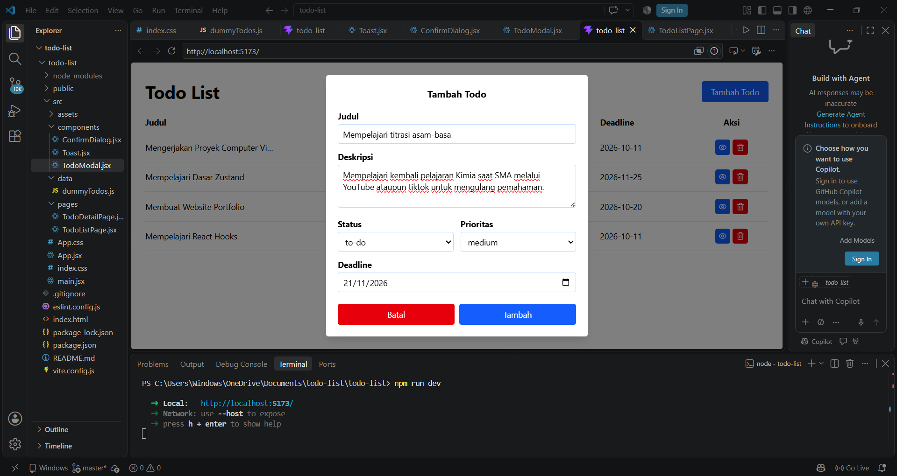
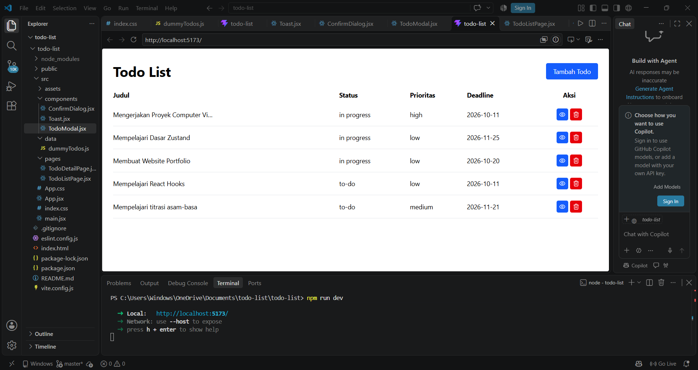
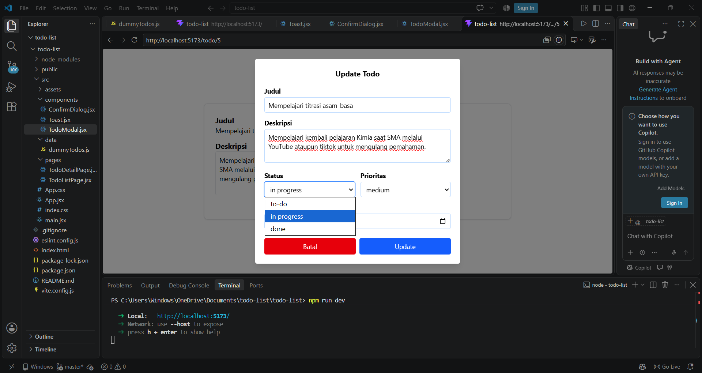

# React + Vite

This template provides a minimal setup to get React working in Vite with HMR and some ESLint rules.

Currently, two official plugins are available:

- [@vitejs/plugin-react](https://github.com/vitejs/vite-plugin-react/blob/main/packages/plugin-react) uses [Oxc](https://oxc.rs)
- [@vitejs/plugin-react-swc](https://github.com/vitejs/vite-plugin-react/blob/main/packages/plugin-react-swc) uses [SWC](https://swc.rs/)

## React Compiler

The React Compiler is not enabled on this template because of its impact on dev & build performances. To add it, see [this documentation](https://react.dev/learn/react-compiler/installation).

## Expanding the ESLint configuration

If you are developing a production application, we recommend using TypeScript with type-aware lint rules enabled. Check out the [TS template](https://github.com/vitejs/vite/tree/main/packages/create-vite/template-react-ts) for information on how to integrate TypeScript and [`typescript-eslint`](https://typescript-eslint.io) in your project.

## Screenshot Hasil Implementasi
Dokumentasi hasil implementasi aplikasi Todo List.

### 1. Tampilan Awal Aplikasi

### 2. Tombol Tambah Todo

### 3. Mengisi Form Todo

### 4. Todo Berhasil Ditambahkan

### 5. Mengecek Detail Todo

### 6. Mengedit Todo

### 7. Hasil Setelah Update

### 8. Menghapus Todo

### 9. Todo Berhasil Dihapus
